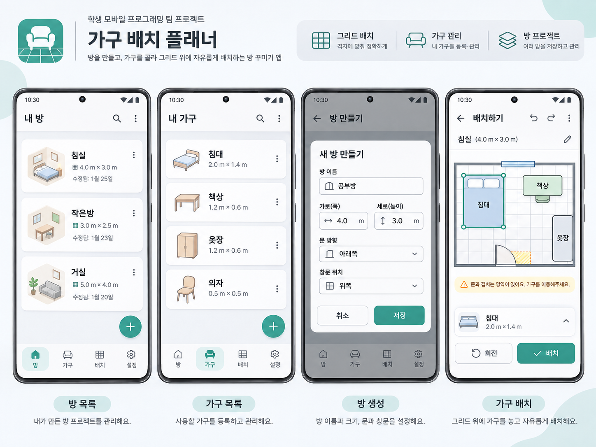

- 목적 및 필요성

    **해결하려는 문제:** 방에 가구를 배치할때, 문이 열리는 반경과 창문의 위치를 고려하다 보면 전체 구조를 갈아엎게 되기도 함. 이 경우 편하게 가구 배치를 할 수 있게 해줌.

    **타겟 사용자:** 방 가구 배치를 큰 규모로 바꾸고자 하는 고객, 서로 다른 방으로 가구를 옮기거나 한 방 내 가구 배치를 통째로 바꾸는 상황에도 효과적임.

- 주요기능

    **핵심 기능1:** 방, 가구를 여러 방배치 프로젝트에서 나누어 관리

    **핵심 기능2:** 방 배치시 격자 칸 내에 가구를 배치, 창문이나 문 위치를 고려

- 앱 흐름도

    메인 화면은 4가지 탭으로 구성

    1. 나의 방 목록
        - 나의 방 목록 흐름도

            **메인 화면**

            ============================================

            (+) 버튼 누를시: 방 추가하기 팝업이 뜸, ‘프리셋 사용’, ‘커스텀 방 제작’ 버튼이 나온다.

            이러한 화면이 나옴.

            방 이름
            가로 세로
            문의 개수 및 가로 크기
            창문의 개수 및 높이
            콘센트의 개수

            ===============================================

            각 방 목록 옆의 … 버튼 누를시:

            방 수정하기 > 위의 세팅 화면으로 연결

            방 삭제하기 > 클릭 시 확인 팝업, 한번 더 확인 누를 시 삭제

    2. 나의 가구 목록
        - 나의 가구 목록 흐름도

            (+)버튼 누를시:

            위의 나의 방과 유사한 화면이 나옴.

            가구 이름/가구의종류
            가로 세로 높이

            ==============================

            … 버튼 누를시:

            가구 수정하기
            가구 삭제하기
            가구 복제

    3. 나의 방 꾸미기 프로젝트
        - 나의 방 프로젝트 흐름도

            각 방 프로젝트가 목록으로 뜬다.

            ================================

            (+) 새 프로젝트 버튼:

            프로젝트 이름
            베이스가 될 방
            ======================

            … 버튼:

            프로젝트 수정
            프로젝트 삭제
            프로젝트 복제

    4. 차별화 기능
- UI 개요

    

    #### 하단 바

    방/가구/배치/설정

    #### 내 방

    각 방 목록을 보여주는 화면
    방 이름, 크기를 보여줌

    옆의 … 버튼으로 팝업 띄우고, 방 삭제/방 수정 버튼이 뜨도록 구현

    하단에는 + 버튼으로 새 방을 추가할 수 있도록 구현

    #### 내 가구

    방 화면과 유사하나, 높이도 설정 가능하도록 구현(위의 이미지에는 가로 세로만 표시되지만, 실제로는 높이도 표시)

    가구는 가로 세로 및 높이를 설정 가능.

    #### 방 만들기

    방 이름, 가로 세로  길이, 문 개수, 창문 개수 설정 가능

    (이미지에는 없지만, 화장실이 딸린 방이거나 창문이 여럿인 방을 고려해 이렇게 설정. 또, 화면처럼 문 위치를 미리 설정하는게 아닌 방 배치 화면에서 문과 창문 위치 직접 설정)

    #### 배치하기

    화면처럼 격자 칸 내에 가구를 배치하는 방식

    위의 … 버튼으로 팝업 띄우고 가구 등 추가가능

    문의 경우 가로 길이 설정가능, 가로 길이와 열리는 방향 기준으로 충돌범위가 설정됨.
    문은 방의 벽면에 고정된 채로 가구처럼 횡/종 방향 이동하여 배치

    창문은 가로 세로 크기 및 바닥에서 떨어진 높이의 3가지 수치 설정 가능.
    바닥에서 떨어진 범위와 가로 길이를 기준으로 경고 범위 설정

    이미지처럼 겹치는 가구는 노란색으로 격자를 표시

사용기술

#### 1. Android Jetpack 요소

  RecyclerView : 수십 개의 방이나 가구 목록을 띄울 때, 화면 밖으로 넘어간 칸(View)을 메모리에서 지우지 않고 새 데이터만 입혀 재활용(Recycle)함으로써 스크롤을 부드럽게 만드는 목록위젯

  ConstraintLayout : 가구 이미지나 버튼 등을 서로의 경계선이나 화면 벽에 고무줄처럼 연결해 배치하는 뷰 그룹, 스마트폰 화면 크기가 달라져도 UI 비율이 깨지지 않게 잡는 역할

#### 2. 데이터저장소

  SharedPreferences :  텍스트나 숫자 같은 아주 간단하고 가벼운 데이터를 '이름-값'으로 묶어서 메모장처럼 저장하는 안드로이드 기본 기능, "마지막으로 편집하던 방 이름",  "앱 최초 실행 여부(안내 팝업 띄우기)"처럼 복잡한 표로 만들 필요가 없는 간단한 설정값을 저장할 때 사용

  Room(SQLite 기반) : 'SQLite'라는 스마트폰 내부용 데이터베이스로 여러 개의 방 목록, 방의 가로세로 크기, 수십 개 가구들의 이름과 화면상 위치(X, Y 좌표) 등 엑셀 표처럼 칸이 나뉘어 있는 복잡한 핵심 데이터를 영구적으로 저장

#### 3. 네트워크

  Firebase SDK활용 : Firebase 전용 통신 라이브러리 SDK를 활용하여 네트워크 처리 해결

#### 4. Firebase 활용

Authentication : 사용자 로그인 처리 및 고유 식별자(UID) 발급

Firestore : 가구 배치 데이터 실시간 동기화 및 초대된 동거인(UID)만 접근할 수 있도록 보안 규칙 권한 관리

역할분담

메인 프론트엔드 : 오윤석

메인 백엔드 : 이민형

총괄 겸 개발 : 강준하
