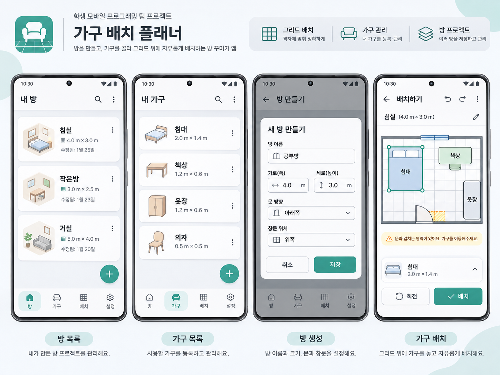

- Purpose and Necessity

    **Problem to solve:** When arranging furniture in a room, taking into account the door's swing radius and the window positions often ends up forcing you to overhaul the entire layout. This app makes furniture arrangement easy in such cases.

    **Target users:** Customers who want to rearrange their room furniture on a large scale. It is also effective when moving furniture between different rooms or completely changing the furniture layout within a single room.

- Main Features

    **Core Feature 1:** Manage rooms and furniture separately across multiple room-layout projects

    **Core Feature 2:** Place furniture within grid cells when arranging a room, taking window and door positions into account

- App Flowchart

    The main screen consists of 4 tabs

    1. My Room List
        - My Room List flowchart

            **Main Screen**

            ============================================

            When the (+) button is pressed: An "Add Room" popup appears with "Use Preset" and "Create Custom Room" buttons.

            The following screen appears.

            Room name
            Width and length
            Number of doors and door width
            Number of windows and window height
            Number of outlets

            ===============================================

            When the … button next to each room in the list is pressed:

            Edit Room > Leads to the settings screen above

            Delete Room > Shows a confirmation popup when clicked; deleted when confirmed once more

    2. My Furniture List
        - My Furniture List flowchart

            When the (+) button is pressed:

            A screen similar to My Rooms above appears.

            Furniture name/Furniture type
            Width, length, height

            ==============================

            When the … button is pressed:

            Edit Furniture
            Delete Furniture
            Duplicate Furniture

    3. My Room Decorating Projects
        - My Room Projects flowchart

            Each room project is displayed as a list.

            ================================

            (+) New Project button:

            Project name
            Base room
            ======================

            … button:

            Edit Project
            Delete Project
            Duplicate Project

    4. Differentiating Features
- UI Overview

    

    #### Bottom Bar

    Rooms/Furniture/Layout/Settings

    #### My Rooms

    A screen showing the list of rooms
    Displays each room's name and size

    Implemented so that the … button next to each room opens a popup with Delete Room/Edit Room buttons

    Implemented so that a new room can be added with the + button at the bottom

    #### My Furniture

    Similar to the Rooms screen, but implemented so that height can also be set (the image above only shows width and length, but height is actually displayed as well)

    Furniture width, length, and height can be set.

    #### Create Room

    Room name, width and length, number of doors, and number of windows can be set

    (Not shown in the image, but designed this way to account for rooms with an attached bathroom or rooms with multiple windows. Also, rather than setting door positions in advance as shown in the image, door and window positions are set directly on the room layout screen)

    #### Arrange

    Furniture is placed within grid cells, as shown on the screen

    The … button at the top opens a popup where furniture and other items can be added

    For doors, the width can be set, and the collision range is determined based on the width and the opening direction.
    Doors remain fixed to the room's walls and are positioned by moving them horizontally/vertically like furniture

    For windows, three values can be set: width, height, and height above the floor.
    The warning range is set based on the height above the floor and the width

    As shown in the image, overlapping furniture is marked with yellow grid cells

Technologies Used

#### 1. Android Jetpack Components

  RecyclerView : A list widget that makes scrolling smooth when displaying dozens of rooms or furniture items, by recycling cells (Views) that have scrolled off-screen—applying only new data to them instead of removing them from memory

  ConstraintLayout : A view group that positions elements such as furniture images and buttons by connecting them like rubber bands to each other's edges or to the screen edges, keeping UI proportions intact even across different smartphone screen sizes

#### 2. Data Storage

  SharedPreferences : A built-in Android feature that stores very simple, lightweight data such as text or numbers as "key-value" pairs, like a notepad. Used to store simple settings that don't need to be structured as complex tables, such as "the name of the last room being edited" or "whether the app is being launched for the first time (to show the guide popup)"

  Room (SQLite-based) : Uses SQLite, an on-device database, to permanently store complex core data organized in columns like an Excel spreadsheet—such as multiple room lists, room width and length, and the names and on-screen positions (X, Y coordinates) of dozens of furniture items

#### 3. Network

  Using the Firebase SDK : Network processing is handled using the Firebase SDK, Firebase's dedicated communication library

#### 4. Using Firebase

Authentication : Handles user login and issues unique identifiers (UIDs)

Firestore : Real-time synchronization of furniture layout data, and permission management via security rules so that only invited roommates (UIDs) can access it

Role Assignment

Lead Frontend : Yunseok Oh

Lead Backend : Minhyung Lee

Project Lead & Developer : Junha Kang
